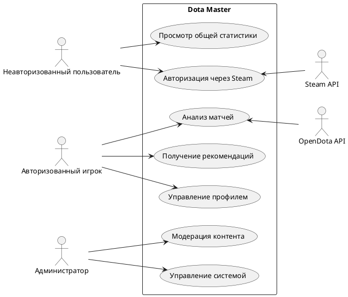
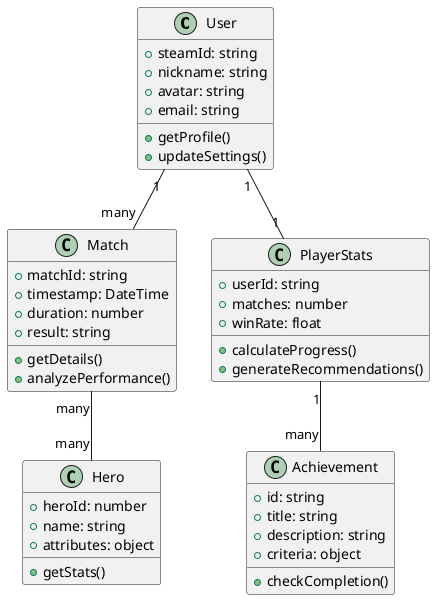
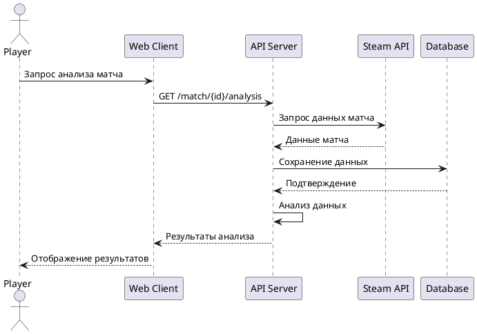
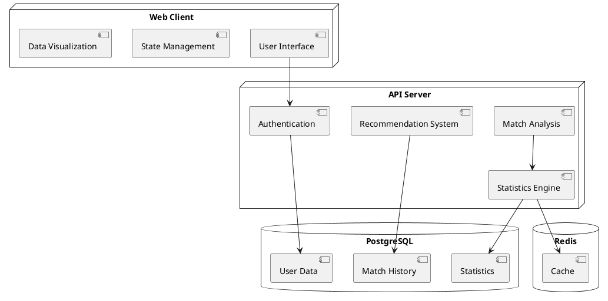

# 2. Моделирование предметной области

## 2.1 Анализ функциональных требований

На основе анализа требований к программному средству были выделены следующие основные группы пользователей системы:
1. Неавторизованные пользователи
2. Авторизованные игроки
3. Администраторы системы

### 2.1.1 Варианты использования системы (Use Cases)

#### Неавторизованные пользователи:
- Просмотр общей статистики
- Просмотр рейтингов игроков
- Авторизация через Steam
- Просмотр публичных профилей игроков

#### Авторизованные игроки:
- Просмотр персональной статистики
- Анализ собственных матчей
- Получение рекомендаций по улучшению игры
- Сравнение статистики с другими игроками
- Участие в сообществах
- Настройка уведомлений
- Отслеживание прогресса достижений

#### Администраторы:
- Управление пользователями
- Модерация контента сообщества
- Управление системой достижений
- Мониторинг производительности системы
- Управление интеграциями

## 2.2 UML-диаграммы

### 2.2.1 Диаграмма вариантов использования (Use Case Diagram)

### 2.2.2 Диаграмма классов (Class Diagram)

### 2.2.3 Диаграмма последовательности (Sequence Diagram)

## 2.3 Диаграмма потоков данных (DFD)

## 2.4 Информационная модель (IDEF1X)

### 2.4.1 Основные сущности

1. Users
   - user_id (PK)
   - steam_id
   - nickname
   - email
   - created_at
   - updated_at

2. Matches
   - match_id (PK)
   - game_mode
   - duration
   - start_time
   - end_time
   - winner_team

3. PlayerMatches
   - player_match_id (PK)
   - user_id (FK)
   - match_id (FK)
   - hero_id
   - kills
   - deaths
   - assists
   - gpm
   - xpm
   - items

4. Heroes
   - hero_id (PK)
   - name
   - attributes
   - roles
   - stats

5. Achievements
   - achievement_id (PK)
   - title
   - description
   - criteria
   - points

6. UserAchievements
   - user_achievement_id (PK)
   - user_id (FK)
   - achievement_id (FK)
   - completed_at
   - progress

## 2.5 Функциональная спецификация

### 2.5.1 Аутентификация и авторизация

1. Система должна обеспечивать:
   - Авторизацию через Steam OAuth
   - Хранение токенов доступа
   - Управление сессиями пользователей
   - Разграничение прав доступа

### 2.5.2 Анализ матчей

1. Система должна анализировать:
   - Эффективность фарма (GPM, XPM)
   - Показатели KDA
   - Выбор предметов
   - Передвижение по карте
   - Тайминги ключевых событий

2. Система должна предоставлять:
   - Визуализацию данных
   - Сравнительный анализ
   - Рекомендации по улучшению

### 2.5.3 Статистика и прогресс

1. Система должна отслеживать:
   - Общую статистику игрока
   - Прогресс по героям
   - Достижения
   - Рейтинг и ранг

2. Система должна обеспечивать:
   - Реал-тайм обновление данных
   - Историю изменений
   - Экспорт статистики

### 2.5.4 Интеграции

1. Система должна интегрироваться с:
   - Steam Web API
   - OpenDota API
   - Twitch API (для стримов)
   - Discord (для уведомлений)

### 2.5.5 Администрирование

1. Система должна предоставлять инструменты для:
   - Управления пользователями
   - Модерации контента
   - Мониторинга производительности
   - Управления интеграциями
   - Анализа метрик

### 2.5.6 Производительность и масштабируемость

1. Система должна обеспечивать:
   - Время отклика API < 200ms
   - Поддержку >10000 одновременных пользователей
   - Обработку >1000 матчей в минуту
   - Автоматическое масштабирование
   - Отказоустойчивость 